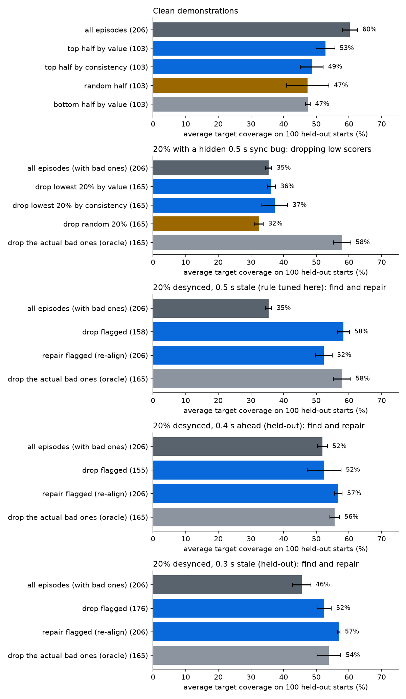

# Handoff Value, Demo 2: which training episodes make a robot policy better?

Task: LeRobot **PushT** (keypoint observations), 206 human demonstrations. Each score comes from 96 small policies trained on random halves of the data. Every comparison below uses 100 simulator starting positions that scoring never saw.

## Clean demonstrations

| Training set | Episodes | Coverage (mean ± sd, 3 seeds) | Full successes |
|---|---|---|---|
| all episodes | 206 | 60.3% ± 2.3% | 6.7% |
| top half by value | 103 | 52.8% ± 2.9% | 9.3% |
| top half by consistency | 103 | 48.7% ± 3.5% | 8.0% |
| random half | 103 | 47.4% ± 6.5% | 7.0% |
| bottom half by value | 103 | 47.5% ± 0.7% | 5.0% |

## 20% of episodes with a hidden sync bug

41 episodes had their actions recorded 0.5 s stale relative to the observations. Every frame is valid, so no video check can see it.

| Score | Finds bad episodes (AUC, 0.5 = chance) | Bad episodes among the lowest-scored 41 |
|---|---|---|
| Value (task success) | 0.70 | 13 of 41 |
| Consistency (action prediction) | 0.75 | 17 of 41 |

| Training set | Episodes | Coverage (mean ± sd, 3 seeds) | Full successes |
|---|---|---|---|
| all episodes (with bad ones) | 206 | 35.4% ± 0.9% | 0.3% |
| drop lowest 20% by value | 165 | 36.2% ± 1.3% | 0.7% |
| drop lowest 20% by consistency | 165 | 37.3% ± 3.9% | 3.3% |
| drop random 20% | 165 | 32.5% ± 1.3% | 1.3% |
| drop the actual bad ones (oracle) | 165 | 58.0% ± 2.6% | 7.0% |

## Finding and repairing hidden sync bugs

For each episode, a policy trained on the other episodes predicts its actions at every time offset within ±1 s, and the offset with the lowest error wins. Offsets are judged against the batch's median, assuming most of a delivery is aligned. An episode at least 3 steps (0.3 s) off the median is flagged, then re-aligned by that amount rather than dropped. No timestamps and no knowledge of which episodes are bad are used.

| Hidden bug in 20% of episodes | Bad found | Clean falsely flagged | Offset fixed within 0.1 s | With bugs | Drop flagged | **Repair flagged** | Drop true bad ones (oracle) |
|---|---|---|---|---|---|---|---|
| 0.5 s stale (rule tuned here) | 41 of 41 | 7 of 165 | 30 of 41 | 35.4% ± 0.9% | 58.3% ± 1.8% | **52.4% ± 2.5%** | 58.0% ± 2.6% |
| 0.4 s ahead (held-out) | 32 of 41 | 19 of 165 | 32 of 41 | 51.9% ± 1.5% | 52.4% ± 5.2% | **56.8% ± 1.2%** | 55.6% ± 1.5% |
| 0.3 s stale (held-out) | 30 of 41 | 0 of 165 | 40 of 41 | 45.6% ± 2.8% | 52.4% ± 2.2% | **56.9% ± 0.3%** | 53.9% ± 3.6% |

The flagging rule (relative to the batch median, 3-step threshold) was chosen after the first run. The two held-out rows use different episodes and different offsets the rule never saw.

## Real robot data: SO-100 teleoperation

`lerobot/svla_so100_pickplace`: a real SO-100 arm, 50 human-teleoperated pick-and-place episodes at 30 fps, using only joint states and actions. We planted offsets between the follower arm's state and the leader arm's actions in 10 of the 50 episodes. There's no simulator here, so this measures detection only. The rule was fixed before running: flag an episode whose best offset is at least 3 frames (0.1 s) from the batch median.

Flags are shown two ways. The model-based scan alone, and **confirmed**: the model-free cross-correlation of state and action changes agrees on the offset within one frame. Confirmed flags are what `value.scan` reports.

| Planted offset | Bad found (scan alone) | Bad found (confirmed) | Clean flagged (scan alone) | Clean flagged (confirmed) | Offset measured within 1 frame |
|---|---|---|---|---|---|
| none (natural data) | n/a | n/a | 0 of 50 | 0 of 50 | natural offset -1 frame (-0.033 s) |
| -0.17 s (-5 frames) | 10 of 10 | **10 of 10** | 0 of 40 | **0 of 40** | 10 of 10 |
| +0.17 s (+5 frames) | 10 of 10 | **8 of 10** | 0 of 40 | **0 of 40** | 8 of 10 |
| -0.33 s (-10 frames) | 10 of 10 | **10 of 10** | 2 of 40 | **0 of 40** | 10 of 10 |
| +0.10 s (+3 frames) | 7 of 10 | **7 of 10** | 0 of 40 | **0 of 40** | 10 of 10 |

Run it on any LeRobot dataset: `python -m value.scan --root <dataset folder> --fps 30`.

## Limits

- Task performance was measured on one simulated task (PushT) with low-dimensional observations and a deliberately simple policy (an MLP with action chunks). Full successes are rare, so coverage is the main measure.
- On the real SO-100 data we measured detection, not task performance: there's no simulator for it.
- All sync bugs were planted constant offsets. Real desync can drift within an episode.
- 3 training seeds per condition, so differences of a few points are within noise.

Runtime: 29.1 minutes for the main experiment, about 3 minutes per sync run, on a laptop (RTX 4050, Ryzen 9 7940HS).
